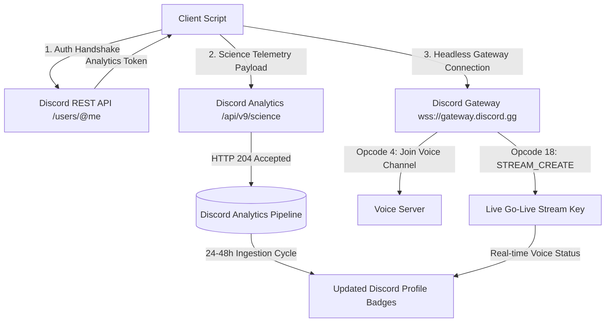

<div align="center">

# Discord Badge Maximizer

**A lightweight, pure Python telemetry and activity engine for Discord profile badges**

<p align="center">
  <a href="https://discord.gg/JaBugGHQ4m"></a>
  <a href="https://python.org"></a>
  <a href="LICENSE"></a>
</p>

<p align="center">
  <a href="#1-maximize-game-variety--game-time-badges-gamespy"></a>
  <a href="#1-maximize-game-variety--game-time-badges-gamespy"></a>
  <a href="#2-maximize-stream-time-badge-streampy"></a>
</p>

<p align="center">
  Programmatically level up your <b>Game Time</b>, <b>Game Variety</b>, and <b>Streaming</b> progression badges by interacting directly with Discord's analytics telemetry endpoint (<code>/api/v9/science</code>) and Voice Gateway protocol.
</p>

*Zero external dependencies • Standard library only • Multi-vector engine*

</div>

---

## Contents

- [What it does](#what-it-does)
- [Features and Tools 🌟](#features-and-tools-)
- [Badges Supported & Tiers](#badges-supported--tiers)
- [How to Obtain Credentials](#how-to-obtain-credentials)
  - [Step 1: Discord Account Token](#step-1-discord-account-token)
  - [Step 2: Cloudflare Clearance Cookie (`cf_clearance`)](#step-2-cloudflare-clearance-cookie-cf_clearance)
- [Step-by-Step Usage Guide](#step-by-step-usage-guide)
  - [1. Maximize Game Variety & Game Time Badges (`games.py`)](#1-maximize-game-variety--game-time-badges-gamespy)
  - [2. Maximize Stream Time Badge (`stream.py`)](#2-maximize-stream-time-badge-streampy)
  - [Live Profile & Badge Inspection (Both Scripts)](#live-profile--badge-inspection-both-scripts)
- [How It Works](#how-it-works)
- [Important Disclaimer](#important-disclaimer)

---

## What it does

Discord tracks user game activity and broadcast hours to award tiered profile progression badges:

- **Game Activity Telemetry:** Discord's desktop client dispatches telemetry events (`launch_game` and `running_game_heartbeat`) to `/api/v9/science`. Because Discord does not run game executables on its servers, the backend trusts authenticated client reports for `duration_tracked_ms`.
- **Stream Activity & Gateway:** The streaming badge tracks hours spent sharing your screen or broadcasting via Go Live in voice channels. Progress is calculated via client telemetry (`video_stream_started`, `video_stream_ended`) and live voice state connections (`STREAM_CREATE` Opcode 18).

This repository provides standalone tools to simulate authentic telemetry packets and maintain headless Go Live broadcasts without running resource-heavy games, GPUs, or software.

---

## Features and Tools 🌟

<details open>
<summary><b>Features ✨ (Click to expand)</b></summary>

- ☑️ **Instant Science Telemetry Forge:** Emits authentic client-side stream and game telemetry events directly to `/api/v9/science`.
- ☑️ **Realistic Historical Session Builder:** Decomposes target hours into organic multi-hour sessions across days/weeks with randomized viewer counts and game titles.
- ☑️ **Headless Gateway AFK Streamer:** Connects directly to Discord Gateway, joins a voice channel, and triggers Opcode 18 `STREAM_CREATE` for real 24/7 Go Live status with **0% CPU and 0% GPU usage**.
- ☑️ **Automated Game Catalog Integration:** Synchronizes with Discord's detectable games list to rotate through hundreds of verified titles for the Game Variety badge.
- ☑️ **Live Profile & Badge Inspector:** Queries Discord's user profile API to display current badge tiers and equipped collectibles directly in your console.
- ☑️ **Shared Authentication State:** Saves your session securely to `session.json` so you only have to provide auth once across both scripts.
- ☑️ **Zero Dependencies:** Pure Python standard library (Python 3.10+). No `pip install` required.

</details>

---

## Badges Supported & Tiers

| Badge | Criteria | Maximum Milestone | Progression Track |
| :--- | :--- | :--- | :--- |
| ⭐ **Game Time** | Cumulative hours spent playing detectable games | **5,000+ hours** | 10 progressive tiers (Casual &rarr; Eternal) |
| ⭐ **Game Variety** | Count of unique detectable games launched | **100+ games** | 10 progressive tiers (Sampler &rarr; Universalist) |
| ⭐ **Streaming** | Hours spent streaming video in voice channels | **5,000+ hours** | 10 progressive tiers (Newcomer &rarr; Phenomenon) |

<details>
<summary><b>View Streaming Badge Tiers (Click to expand)</b></summary>

| Tier | Name | Target Hours |
| :---: | :--- | :---: |
| **1** | Newcomer | 1 hour |
| **2** | Fledgling | 5 hours |
| **3** | Breakout | 20 hours |
| **4** | Standout | 75 hours |
| **5** | Trendsetter | 150 hours |
| **6** | Headliner | 300 hours |
| **7** | Star | 500 hours |
| **8** | Sensation | 1,000 hours |
| **9** | Visionary | 2,000 hours |
| **10** | Phenomenon | 5,000 hours |

</details>

---

## How to Obtain Credentials

Before launching either tool, grab your Discord authorization token and Cloudflare cookie.

### Step 1: Discord Account Token

1. Open Discord in your web browser (Chrome, Edge, Firefox, Brave) and navigate to **[https://discord.com/channels/@me](https://discord.com/channels/@me)**.
2. Press `Ctrl + Shift + I` (or `Cmd + Option + I` on macOS) to open Developer Tools.
3. Switch to the **Network** tab at the top of Developer Tools.
4. In the filter box, type `science` or `messages?limit=10`.
   *(If the list is empty, open any Direct Message conversation or channel to generate traffic).*
5. Click on any outgoing request and navigate to the **Headers** tab.
6. Scroll down to **Request Headers** and locate **`authorization`**.
7. Copy the value of `authorization` — this is your Discord token.

---

### Step 2: Cloudflare Clearance Cookie (`cf_clearance`)

Choose either of the two methods below to copy your `cf_clearance` cookie value:

#### Method 1: Via Application Tab (Recommended & Easiest)
1. In Developer Tools (`Ctrl + Shift + I`), click on the **Application** tab (or **Storage** tab in Firefox).
2. In the left sidebar, expand **Cookies** &rarr; click on **`https://discord.com`**.
3. In the cookie table, locate the row named **`cf_clearance`**.
4. Click on `cf_clearance` and copy the value shown in the bottom inspection box.

#### Method 2: Via Network Tab
1. In Developer Tools &rarr; **Network** tab, click on any filtered `science` request.
2. Under **Request Headers**, locate the **`cookie`** entry.
3. The cookie header contains multiple values separated by semicolons. Find `cf_clearance=...;`.
4. Copy the value starting directly after `cf_clearance=` and ending right before the trailing `;` (or pass the full cookie header; both tools parse it automatically).

> [!TIP]
> Credentials are automatically saved to `session.json`. You only need to enter them once; both `games.py` and `stream.py` read from this shared session.

---

## Step-by-Step Usage Guide

Ensure Python 3.10+ is installed:
```bash
python --version
```

---

### 1. Maximize Game Variety & Game Time Badges (`games.py`)

Run the game maximizer:
```bash
python games.py
```

1. Select **Option 1**: `Claim Games (Game Time & Game Variety)`.
2. **Target games count:** Enter how many unique games you want to claim for the **Game Variety** badge (e.g. `100` to reach the maximum Tier 10 milestone, or press enter for `all`).
3. **Hours per game:** Enter the hours to allocate to each game (e.g. `50`).
4. **Badge Progression Calculation:**
   $$\text{Total Hours Credited} = \text{Total Games} \times \text{Hours per Game}$$
   *Example:* Entering **100 games** with **50 hours per game** credits **100 unique games** (Tier 10 Game Variety) and **5,000 hours** of total playtime (Tier 10 Game Time) simultaneously!

> [!NOTE]
> **Executable Fingerprint:**
> The maximizer functions completely and claims both badges **without requiring a fingerprint**. However, if you experience delayed badge updates or prefer maximum client legitimacy matching your local Windows machine, you can configure an authentic signature anytime via **Option 4** (`Configure Executable Fingerprint`).

---

### 2. Maximize Stream Time Badge (`stream.py`)

Run the stream maximizer:
```bash
python stream.py
```

#### Option 1: Instant Telemetry Forge (Fastest Hours Injection)
1. Select **Option 1** from the menu.
2. Enter your target hours to claim (e.g. `5000` for the Tier 10 *Phenomenon* badge).
3. Optional: Enter a target server ID and voice channel ID, or press enter to randomize.
4. **Choose Injection Strategy:**
   - **Strategy 2: Realistic Session Batches (Recommended)** &rarr; Decomposes target hours into organic 10-hour stream blocks with randomized viewer counts (2–5 viewers) and sequential timestamps.
   - **Strategy 1: Single High-Impact Session** &rarr; Submits the entire target duration in one large broadcast session.

#### Option 2: Realistic Historical Stream Generator (Organic Multi-Week History)
1. Select **Option 2** from the menu.
2. Enter the cumulative hours you wish to generate (e.g. `500`).
3. The engine simulates a natural multi-week streaming history spanning the past **30 to 90 days**, featuring:
   - Randomized stream lengths (2.0h to 5.5h per session)
   - Organic viewer count fluctuations (2–7 viewers)
   - Real detectable game titles (Valorant, CS2, Minecraft, League of Legends, GTA V)
   - Natural rest gaps (20h to 36h) between broadcasts

#### Option 3: Headless Gateway Go Live Streamer (24/7 Live Stream without Discord)
1. Select **Option 3** from the menu.
2. Enter your **Server (Guild) ID** and **Voice Channel ID**.
3. The engine connects directly to Discord's Voice Gateway, enters the channel headlessly, and triggers Opcode 18 `STREAM_CREATE`.
4. Your account immediately shows the purple **LIVE / Streaming** badge in the voice channel with **0% CPU and 0% GPU usage**. Leave it running in the background as long as you want!

---

### Live Profile & Badge Inspection (Both Scripts)

> [!TIP]
> **Check Your Progress Anytime:**
> You do not need to log into Discord on another client to verify your profile badges. You can query your live Discord profile data and equipped badges at any time by selecting:
> - **Option 2** in `games.py` (`Inspect Discord Profile & Badges`)
> - **Option 4** in `stream.py` (`Inspect Discord Profile & Badges`)
>
> This queries `https://discord.com/api/v9/users/{user_id}/profile` and outputs your display name, snowflake ID, and every equipped profile badge.

---

> [!IMPORTANT]
> **Badge Synchronization Period (24h – 48h):**
> Discord does not grant progression badges in real-time. Once the script outputs `HTTP 204 Accepted`, the events are recorded in Discord's backend data warehouse. Profile badge tier upgrades typically reflect on your profile within **24 to 48 hours** following Discord's scheduled analytics sync.

---

## How It Works



---

## Important Disclaimer

> [!WARNING]
> This project is created for educational and security research purposes only. Automating user account telemetry and spoofing activity metrics violates Discord's Terms of Service. Use at your own discretion on accounts you are comfortable risking.

---

<div align="center">

[](https://discord.gg/JaBugGHQ4m)

Released under the [MIT License](LICENSE).

</div>
